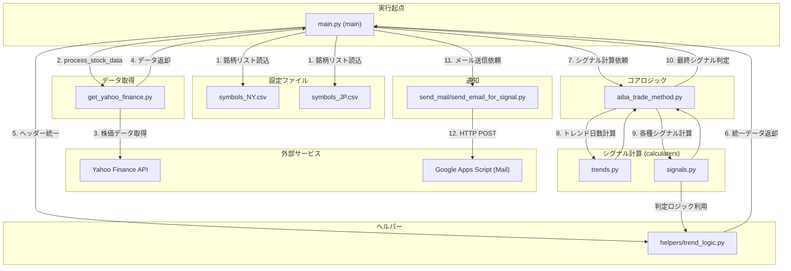

## KABUtrade システム仕様書

### 1. 概要

KABUtrade は、株価データに基づいて売買シグナルを生成し、メールで通知するシステムです。移動平均線、ゴールデンクロス/デッドクロス、パンパカパン、下半身、くちばしといった複数のテクニカル分析手法を用いてシグナルを判定します。

### 2. システム構成

本システムは、以下の主要なコンポーネントで構成されています。

- **データ取得モジュール**: Yahoo Finance から株価データを取得します。
- **計算モジュール**: 取得した株価データに対して、移動平均線、トレンド日数、各種売買シグナルを計算します。
- **シグナル判定モジュール**: 計算されたデータから最終的な売買シグナルを判定します。
- **通知モジュール**: 生成されたシグナルを Google Apps Script (GAS) を介してメールで通知します。
- **設定ファイル**: 監視対象の銘柄リストを管理します。

### 3. 各モジュールの詳細

#### 3.1. `src/main.py`

システムのメインエントリーポイントです。

- **機能**:
    - Yahoo Finance から株価データを取得します。
    - 取得した株価データを `aiba_trade_method.main` 関数に渡し、売買シグナルを計算します。
    - 計算されたシグナルを `send_email_for_signal.sendEmailForSignal` 関数に渡し、メールで通知します。
    - `src/symbols/symbols_NY.csv` と `src/symbols/symbols_JP.csv` から監視対象の銘柄リストを読み込みます。
- **主要関数**:
    - `process_stock_data(symbol: str) -> Tuple[str, str, str]`:
        - 指定された銘柄の株価データをYahoo Financeから取得し、シグナルを計算します。
        - 取得したデータが空の場合はスキップします。
        - ヘッダー名を統一します。
        - `aiba_trade_method.main` を呼び出し、シグナルを計算します。
        - 銘柄、シグナルタイプ、シグナル種別を返します。
    - `main()`:
        - 銘柄リストを読み込み、各銘柄に対して `process_stock_data` を呼び出します。
        - 全てのシグナルをまとめて `send_email_for_signal.sendEmailForSignal` に渡します。

#### 3.2. `src/aiba_trade_method.py`

テクニカル分析に基づく売買シグナルを計算します。

- **機能**:
    - 移動平均線 (SMA) を計算します。
    - 上昇トレンドと下降トレンドの日数をカウントします。
    - 陽線と陰線を判定します。
    - `calculaters.signals` モジュールから各種シグナルを計算します。
    - 最終的な売買シグナルを判定し、返します。
- **主要定数**:
    - `SMA_PERIODS`: 移動平均線の期間リスト (5, 10, 20, 25, 30, 60, 75, 100, 200, 300)。
    - `UP_DOWN_PERIODS`: 連続上昇/下落日数の期間リスト (9, 13)。
    - `CROSS_PERIODS`: ゴールデンクロス/デッドクロスの期間リスト (25, 75)。
- **主要関数**:
    - `calculate_sma(data: pd.DataFrame, periods: List[int]) -> pd.DataFrame`: 指定された期間の移動平均線を計算し、データフレームに追加します。
    - `check_cross_signals(latest_data: pd.Series) -> Tuple[Optional[str], Optional[str]]`: ゴールデンクロスまたはデッドクロスのシグナルをチェックします。
    - `check_up_down_signals(latest_data: pd.Series, UP_DOWN_PERIODS: List[int]) -> Tuple[Optional[str], Optional[str]]`: 連続上昇/下落日数に基づくシグナルをチェックします。
    - `check_other_signals(latest_data: pd.Series) -> Tuple[Optional[str], Optional[str]]`: パンパカパン、下半身、くちばしなどのシグナルをチェックします。
    - `get_latest_signals(kabuData: pd.DataFrame, UP_DOWN_PERIODS: List[int]) -> Tuple[Optional[str], Optional[str]]`: 最新のデータから最終的なシグナルを判定します。
    - `main(kabuData: pd.DataFrame) -> Tuple[str, str]`: 移動平均線、トレンド、シグナルを計算し、最終的なシグナルを返します。

#### 3.3. `src/calculaters/signals.py`

各種売買シグナルを計算します。

- **機能**:
    - 連続陽線/陰線に基づく売買シグナルを計算します。
    - パンパカパン（移動平均線の順序）に基づく売買シグナルを計算します。
    - ゴールデンクロス/デッドクロスに基づく売買シグナルを計算します。
    - 下半身（ローソク足と移動平均線の関係）に基づく売買シグナルを計算します。
    - くちばし（移動平均線の交差）に基づく売買シグナルを計算します。
- **主要関数**:
    - `calculate_signals(kabuData: pd.DataFrame, UP_DOWN_PERIODS: List[int], SMA_PERIODS: List[int], CROSS_PERIODS: List[int]) -> pd.DataFrame`: 各種シグナルを計算し、データフレームに追加します。

#### 3.4. `src/calculaters/trends.py`

トレンドの日数をカウントします。

- **機能**:
    - 上昇トレンドと下降トレンドの日数を計算します。
    - トレンドの閾値は5日です。
- **主要関数**:
    - `count_trend_days(kabuData: pd.DataFrame) -> pd.DataFrame`: 上昇トレンドと下降トレンドの日数をデータフレームに追加します。
    - `calculate_up_trend(kabuData: pd.DataFrame, i: int) -> int`: 指定されたインデックスにおける上昇トレンドの日数を計算します。
    - `calculate_down_trend(kabuData: pd.DataFrame, i: int) -> int`: 指定されたインデックスにおける下降トレンドの日数を計算します。

#### 3.5. `src/get_stock_data/get_yahoo_finance.py`

Yahoo Finance から株価データを取得します。

- **機能**:
    - Yahoo Finance API を使用して株価データを取得します。
    - 取得失敗時のリトライ処理を実装しています。
    - 日本株の場合、銘柄コードに ".T" を付与します。
- **主要関数**:
    - `load_api_key() -> str`: 環境変数から API キーを読み込みます。
    - `get_stock_data(symbol: str, start: str, end: str, retries: int = 3) -> pd.DataFrame`: 指定された銘柄、期間の株価データを取得します。
    - `plot_stock_data(symbol: str, start: str, end: str) -> pd.DataFrame`: 株価データをプロットします（現在はコメントアウトされています）。
    - `get_yfinance_stock_data(symbol: str) -> pd.DataFrame`: Yahoo Finance から過去10年間の株価データを取得します。

#### 3.6. `src/google_app_scripts/postMail.js`

Google Apps Script (GAS) で動作するメール送信スクリプトです。

- **機能**:
    - HTTP POST リクエストを受け取り、シグナル情報に基づいてメールを送信します。
    - メール本文には、シグナルの種類と、各シグナルの説明が含まれます。
    - メール送信先は Google スプレッドシートから取得します。
- **主要関数**:
    - `doGet(e)`: GET リクエストに対する応答（POST のみ受け付ける旨のメッセージを返します）。
    - `doPost(e)`: POST リクエストを受け取り、メールを送信します。

#### 3.7. `src/helpers/trend_logic.py`

トレンド判定やシグナル計算の補助関数を提供します。

- **機能**:
    - データフレームのヘッダー名を統一します。`yfinance`から取得したMultiIndexのDataFrameをフラット化し、適切な列名にリネームします。
    - 連続陽線/陰線、ゴールデンクロス/デッドクロス、パンパカパン、下半身、くちばしなどの判定ロジックを提供します。
- **主要関数**:
    - `standardize_headers(kabuData: pd.DataFrame) -> pd.DataFrame`: ヘッダー名を統一します。
    - `is_buy_signal(kabuData: pd.DataFrame, period: int) -> pd.Series`: 買いシグナル（連続陰線または75日線突破）を判定します。
    - `is_sell_signal(kabuData: pd.DataFrame, period: int) -> pd.Series`: 売りシグナル（連続陽線または75日線突破）を判定します。
    - `is_pampakapam(row: pd.Series, SMA_PERIODS: List[int], is_buy_signal: bool) -> bool`: パンパカパンを判定します。
    - `is_golden_cross(kabuData: pd.DataFrame, CROSS_PERIODS: List[int]) -> pd.Series`: ゴールデンクロスを判定します。
    - `is_dead_cross(kabuData: pd.DataFrame, CROSS_PERIODS: List[int]) -> pd.Series`: デッドクロスを判定します。
    - `is_trend(kabuData: pd.DataFrame, column: str, direction: str) -> pd.Series`: 指定されたカラムのトレンド方向を判定します。
    - `is_break_5d(kabuData: pd.DataFrame) -> pd.Series`: 5日線を実体で上抜けたかを判定します。
    - `is_break_down_5d(kabuData: pd.DataFrame) -> pd.Series`: 5日線を実体で下抜けたかを判定します。

#### 3.9. `src/send_mail/send_email_for_signal.py`

GAS アプリケーションを介してメールを送信します。

- **機能**:
    - シグナルデータを整形し、GAS アプリケーションの URL に POST リクエストを送信します。
- **主要関数**:
    - `sendEmailForSignal(signals)`: シグナルリストを受け取り、GAS アプリケーションに送信します。

#### 3.10. `src/symbols/symbols_JP.csv` および `src/symbols/symbols_NY.csv`

監視対象の日本株および米国株の銘柄リストです。

- **内容**:
    - `symbol`: 銘柄コード
    - `company`: 会社名

#### 3.11. `src/check_lib.py`

SSL バージョンを確認するためのスクリプトです。

- **機能**:
    - インストールされている OpenSSL のバージョンを出力します。

### 4. 関数関連図（Mermaid）

### 5. ワークフロー

1. `main.py` が実行されます。
2. `main.py` は `src/symbols/symbols_NY.csv` と `src/symbols/symbols_JP.csv` から銘柄リストを読み込みます。
3. 各銘柄に対して `process_stock_data` 関数を呼び出します。
4. `process_stock_data` は、Yahoo Finance から株価データを取得します。
5. 取得した株価データは `aiba_trade_method.main` に渡されます。
6. `aiba_trade_method.main` は、移動平均線、トレンド、各種シグナル（ゴールデンクロス/デッドクロス、パンパカパン、下半身、くちばしなど）を計算します。
7. 最終的なシグナルが `main.py` に返されます。
8. 全ての銘柄のシグナルが収集された後、`send_email_for_signal.sendEmailForSignal` を介して Google Apps Script に送信されます。
9. Google Apps Script は、受け取ったシグナル情報に基づいてメールを生成し、指定されたメールアドレスに送信します。

### 6. 今後の改善点

- **エラーハンドリングの強化**: 各モジュールでのエラーハンドリングをより詳細に行い、堅牢性を高める。
- **設定の一元化**: `SMA_PERIODS` などの定数を設定ファイルにまとめる。
- **テストコードの拡充**: 各モジュールに対する単体テストおよび結合テストを拡充する。
- **ログ出力の改善**: より詳細なログを出力し、デバッグや運用時の監視を容易にする。
- **プロット機能の有効化**: `get_yahoo_finance.py` 内のプロット機能を有効にし、視覚的な分析を可能にする。
- **シグナル通知のカスタマイズ**: メール通知のフォーマットや内容をユーザーがカスタマイズできるようにする。
